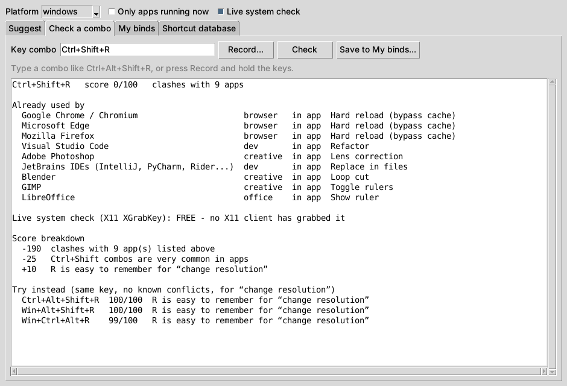

# BindsMaker

**Find keyboard shortcuts that no other app is using.**

You pick `Ctrl+Shift+R` for your resolution-switch hotkey, and later find out
that every browser uses it for hard reload, VS Code uses it for Refactor, and
JetBrains uses it for Replace in files. BindsMaker catches that before it
happens. It checks a combo against a database of the shortcuts that common apps
and operating systems use, asks your OS whether a running program has already
grabbed it, and suggests uncommon combos that are free and easy to remember.



## What it does

- **Check a combo.** See every known app that uses it, whether a running
  program has registered it right now, and a score with the reasons behind it.
  If the combo clashes, you get conflict-free alternatives that keep the same
  key.
- **Suggest combos.** Describe what the bind is for (for example "change
  resolution") and get a ranked list of free combos. Keys that match your
  description (R, for resolution) rank higher.
- **Live system check.** On Windows it tries `RegisterHotKey`, and on Linux/X11
  it tries `XGrabKey`. If the OS refuses, some running program (AutoHotkey,
  OBS, Discord, NVIDIA, your desktop...) already owns the combo.
- **Knows about the less obvious traps:**
  - On many European keyboard layouts, `Ctrl+Alt` is AltGr. `Ctrl+Alt+E`
    types € and `Ctrl+Alt+Q` types @ on a German layout.
  - On Windows 11, `Win+Ctrl+Alt+Shift+<letter>` is reserved by the Office key.
  - The Xbox Game Bar, the NVIDIA overlay and AMD Adrenalin all have global
    hotkeys.
  - Gaming keyboards often disable the Win key in game mode.
  - GNOME uses `Ctrl+Alt+Shift+R` for screen recording.
- **Save your binds** (*My binds*). Combos you save are treated as taken from
  then on, so you never suggest the same combo to yourself twice.
- **Export** your binds as a ready-to-run **AutoHotkey v2** script (Windows) or
  an **xbindkeys** config (Linux).
- **Only apps running now.** You can limit the check to apps that are open at
  the moment.

The database covers 35 apps and about 1,000 shortcuts:

- Windows, GNOME and KDE
- Chrome, Firefox and Edge
- VS Code, JetBrains IDEs, Visual Studio and terminals
- Discord, Slack, Teams and Zoom
- Office and LibreOffice
- Photoshop, Premiere/After Effects, Blender and GIMP
- NVIDIA, AMD, Steam and the Xbox Game Bar
- PowerToys, ShareX, Spotify and more

## Install

Requires Python 3.9+ and has no other dependencies.

```sh
git clone https://github.com/L1NKN/BindsMaker
cd BindsMaker
pip install .
```

To open the desktop app, run `bindsmaker gui`, or `bindsmaker-gui` with no
console window on Windows. On Linux you may need `sudo apt install python3-tk`.

You can also run it without installing: `python -m bindsmaker ...`

## Command line

```console
$ bindsmaker check ctrl+shift+r
Ctrl+Shift+R   score 0/100   clashes with 9 apps

Already used by
  Google Chrome / Chromium  browser   in app  Hard reload (bypass cache)
  Microsoft Edge            browser   in app  Hard reload (bypass cache)
  Mozilla Firefox           browser   in app  Hard reload (bypass cache)
  Visual Studio Code        dev       in app  Refactor
  ...

Live system check (Windows RegisterHotKey): FREE - no running program has registered it as a global hotkey

Try instead (same key, no known conflicts)
  Ctrl+Alt+Shift+R  93/100  Ctrl+Alt+Shift combos are rarely used by apps
  ...

$ bindsmaker suggest change resolution
Suggested keybinds for “change resolution”  (windows, 32 apps checked, live-checked)

  #   Combo             Score  Why
  1   Ctrl+Alt+Shift+R  100    R is easy to remember for “change resolution”; ...
  2   Win+Alt+Shift+R   100    R is easy to remember for “change resolution”; ...
  ...

$ bindsmaker reserve ctrl+alt+shift+r --label "Change resolution" --command "C:\Tools\QRes.exe /x:1920 /y:1080"
$ bindsmaker export -o mybinds.ahk     # double-click mybinds.ahk to activate your binds
```

| Command | What it does |
| --- | --- |
| `check COMBO [purpose...]` | Show conflicts, the live check, the score and alternatives. Exits with 1 if the combo is blocked or taken. |
| `suggest [purpose...]` | Suggest free combos. Options: `-n 20`, `--families "Ctrl+Alt+Shift,Win+Alt"`, `--keys letters,digits,function,extended,punctuation,navigation,numpad`, `--key R`, `--avoid COMBO`, `--allow-conflicts`. |
| `reserve COMBO -l LABEL [-c COMMAND]` | Save a combo to *My binds*. It refuses a combo that clashes unless you add `--force`. |
| `release COMBO` | Remove a combo from *My binds*. |
| `mine` | List your binds. |
| `export [--format ahk\|xbindkeys] [-o FILE]` | Write your binds as a script. |
| `apps` / `show APP_ID` | Browse the shortcut database. |
| `gui` | Open the desktop app. |

`check` and `suggest` also accept these options:

- `--platform windows|linux` checks another platform's shortcuts.
- `--apps chrome,discord` limits the check to those apps.
- `--running` limits the check to apps that are running right now.
- `--no-live` skips the live system check.

Combos are written the usual way, and case and order don't matter:

- `ctrl+shift+r` and `Shift+Ctrl+R` are the same combo.
- `Win`, `Super` and `Meta` all mean the Windows/Super key.
- `AltGr` means `Ctrl+Alt`.
- Other keys: `F13`–`F24`, `PrintScreen`, `PageUp`, `Num5`, and punctuation
  such as `;` or `[`.

## How the score works

Every combo starts at 100 and loses points for these things:

| Penalty | Reason |
| --- | --- |
| blocked (score 0) | A system-wide shortcut (OS, overlay, launcher, or one of your saved binds) uses it, or it would just type a character. |
| −10 to −30 per app | An app uses it inside its own window. The penalty is bigger for more popular apps. Combos like this are hidden unless you pass `--allow-conflicts`. |
| −2 to −40 | How crowded the modifier family is. `Ctrl+X` and `Ctrl+Shift+X` are very crowded. `Ctrl+Alt+Shift+X` and `Win+Alt+Shift+X` are rare. |
| −12 to −22 | `Ctrl+Alt` overlaps with AltGr. The penalty is bigger if that key types a character on a common layout. |
| −3 / −10 | Three or four modifiers are harder to press. |
| −1 to −8 | The key position: two-handed reach, punctuation that moves around between layouts, a numpad that laptops don't have, or F13–F24 needing a macro key. |
| −4 | The combo uses the Win key, which gaming keyboards often disable in game mode. |
| +4 / +10 | The key matches a word in what you said the bind is for. |

## Adding apps

Drop a JSON file into your config folder's `apps` directory:

- **Windows:** `%APPDATA%\BindsMaker\apps\`
- **Linux:** `~/.config/bindsmaker/apps/`

The file uses the same format as the built-in files in
[`bindsmaker/data/`](bindsmaker/data):

```json
{
  "id": "my-game",
  "name": "My Game",
  "category": "gaming",
  "popularity": "low",
  "scope": "app",
  "platforms": ["windows"],
  "processes": ["mygame.exe"],
  "shortcuts": {
    "Ctrl+Shift+K": "Toggle kill feed",
    "Alt+F9": { "action": "Clip last 30s", "scope": "global" }
  }
}
```

- `scope: "global"` means the shortcut works system-wide, so the combo is
  blocked entirely.
- `scope: "app"` means it only works while that app is focused.
- `processes` lets **Only apps running now** detect the app.

Corrections and new apps for the built-in database are very welcome. App
shortcuts change between versions, and some apps let you remap them.

## Limitations

- The live check only sees hotkeys registered through the OS. It cannot see
  shortcuts that only work inside a focused app, or programs that use
  low-level keyboard hooks. That's what the database is for.
- Wayland doesn't let apps inspect global shortcuts, so on Wayland only the
  database is used.
- macOS isn't covered by the database yet.

## Development

```sh
pip install -e ".[test]"
pytest
```
